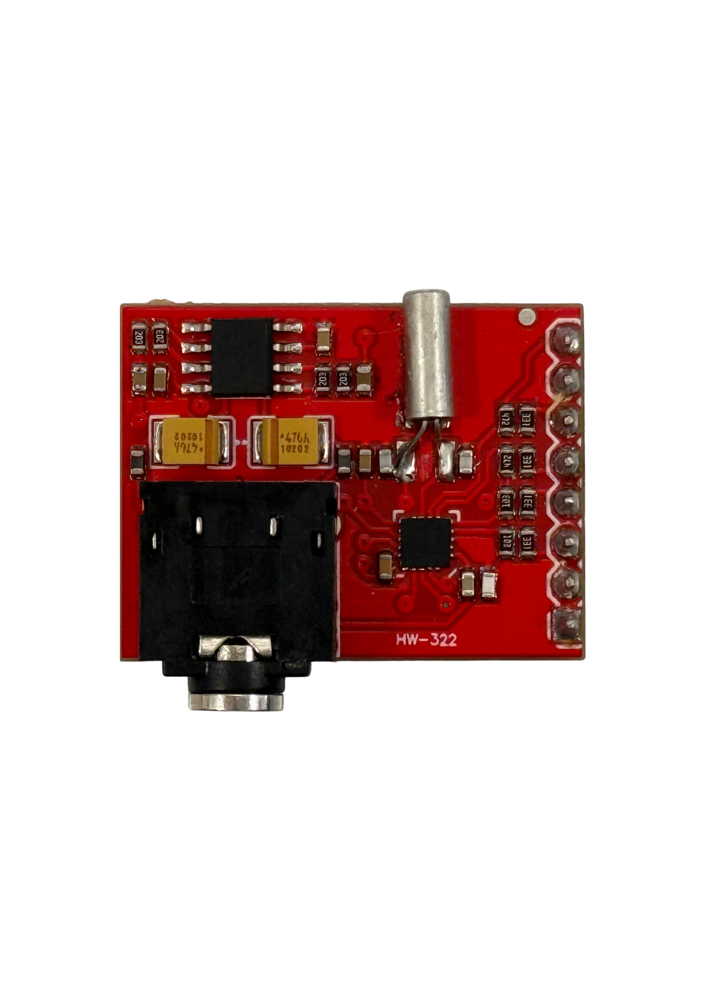
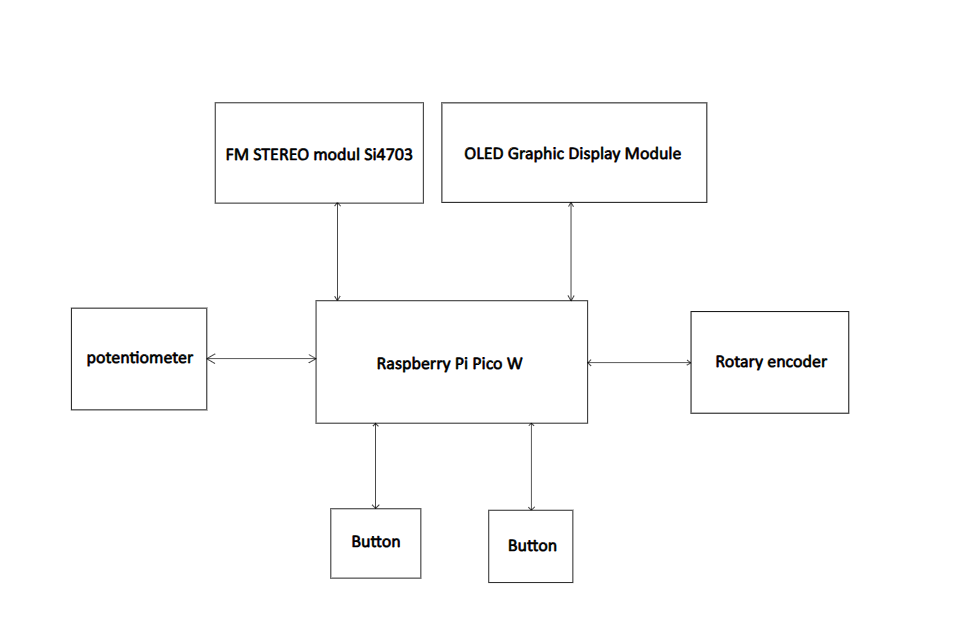

# FM radio receiver with digital tuning
This is a project for Digital Electronics 2 (BPC-DE2) on Brno University of Technology BUT FEEC.  
The goal of this project is to make a fully functional FM radion based on Raspberry PI Pico W.

## Team members
+ **Martin Morávek** - *SW engineer + documentation*
+ **Adrian Munteanu** - *SW engineer and design*
+ **Antonín Navrkal** - *HW and SW engineer*
+ **Ondřej Pavliš** - *HW and SW engineer + documentation*

## Components used and Pin/Bus plan
### Raspberry Pi Pico W

| OLED Graphic Display Module | Signal  ->  GPIO / Pin |
| :--- | :--- |
|  | SDA  ->  GP4 SCL  ->  GP5 VCC  ->  3V3 GND  ->  GND |

| Rotary encoder | Signal  ->  GPIO / Pin |
| :--- | :--- |
|  | CLK  ->  GP16 DT  ->  GP17 SW  ->  GP15 +  ->  3V3 GND  ->  GND |

| FM STEREO module Si4703 | Signal -> GPIO / Pin |
| :--- | :--- |
|  | SDIO -> GP4 SCLK -> GP5 RST -> GP6 GPIO2 -> GP7 VIN -> 3V3 GND -> GND |

| Potentiometer | Signal -> GPIO / Pin |
| :--- | :--- |
|  | Middle pin -> GP26 Left pin -> 3V3 Right pin -> GND |

| 2x Buttons | Signal -> GPIO / Pin |
| :--- | :--- |
|  | **Button 1** IN -> GP11 OUT -> GND  **Button 2** IN -> GP12 OUT -> GND |

## Block diagram

## Timing/concurrency plan  
| **Week**| **Plan** |
|---|---|
| 1. | Team members, creating GitHub repository, approval on Block diagram / pinout |
| 2. | Testing modules / display, create complete wiring diagram  |
| 3. | Wiring of the entire circuit and putting it into operation  |
| 4. | Bug fixes, finishing documentation, making poster / short video  |
| 5. | Demonstration and defense |

