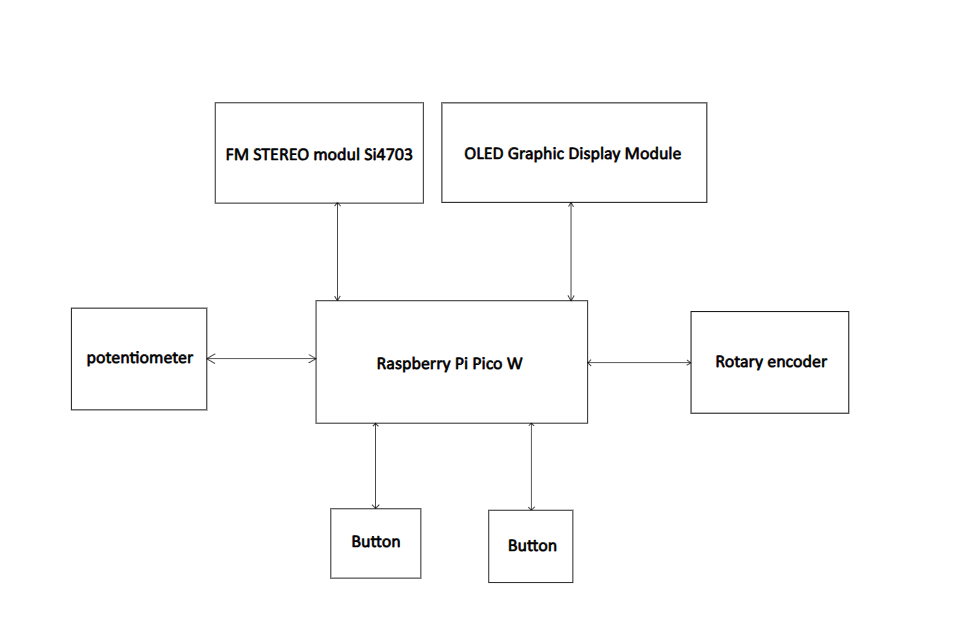

# FM-radio-receiver-with-digital-tuning
This is a project for Digital Electronics 2 (BPC-DE2) on Brno University of Technology BUT FEEC.
## Team members:
+ **Martin Morávek** - *SW engineer + documentation*
+ **Adrian Munteanu** - *SW engineer and design*
+ **Antonín Navrkal** - *HW and SW engineer*
+ **Ondřej Pavliš** - *HW and SW engineer + documentation*

## Components used:
+ Raspberry Pi Pico W
+ OLED Graphic Display Module
+ Rotary encoder
+ FM STEREO modul Si4703
+ Potencimeter
+ 2x Buttons

## Block schematic

## Pin/Bus plan

| Periferie | Signal | GPIO / Pin |
|---|---|---|
| **Si4703 FM modul** | SDIO (SDA) | GP4 (I2C0 SDA) |
| | SCLK (SCL) | GP5 (I2C0 SCL) |
| | RST | GP6 |
| | GPIO2 / STC (volitelně) | GP7 |
| | VIN | 3V3(OUT) |
| | GND | GND |
| **OLED displej** | SDA | GP4 (sdílená I2C0) |
| | SCL | GP5 (sdílená I2C0) |
| | VCC | 3V3(OUT) |
| | GND | GND |
| **Potenciometr ** | Střed (wiper) | GP26 (ADC0) |
| | Jedna krajní svorka | 3V3(OUT) |
| | Druhá krajní svorka | AGND |
| **Rotační enkodér** | CLK (A) | GP8 |
| | DT (B) | GP9 |
| | SW (tlačítko) | GP10 |
| | + | 3V3(OUT) |
| | GND | GND |
| **Tlačítko 1** | Jeden vývod | GP11 |
| | Druhý vývod | GND |
| **Tlačítko 2** | Jeden vývod | GP12 |
| | Druhý vývod | GND |
