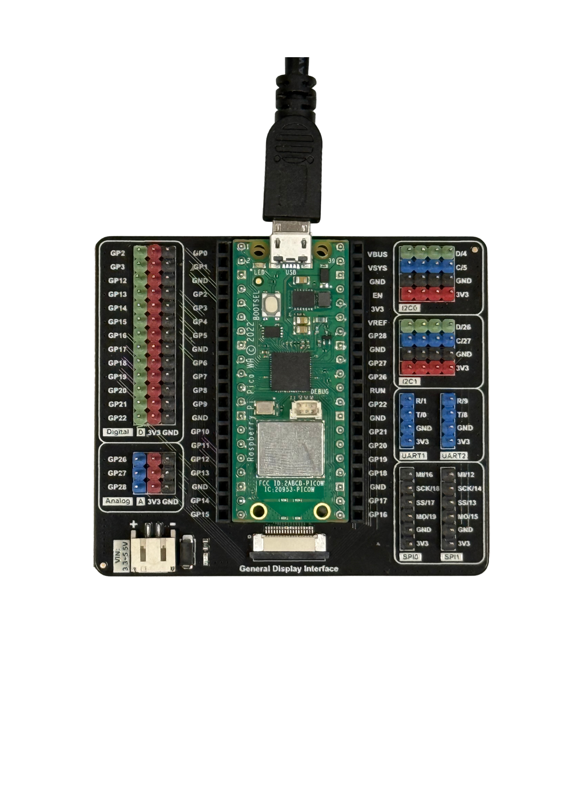
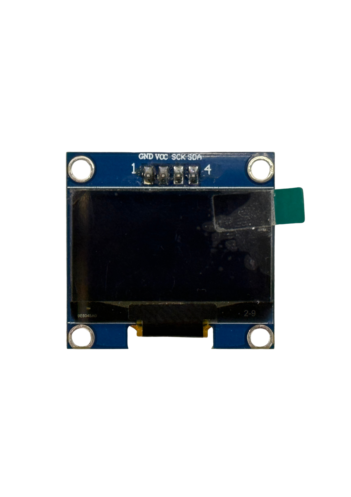
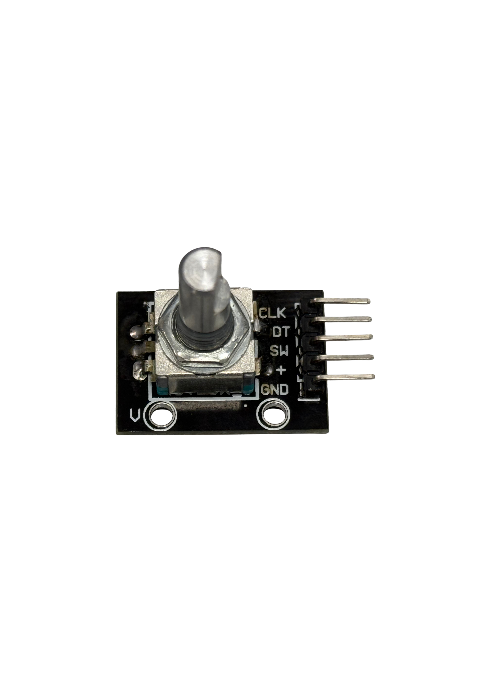
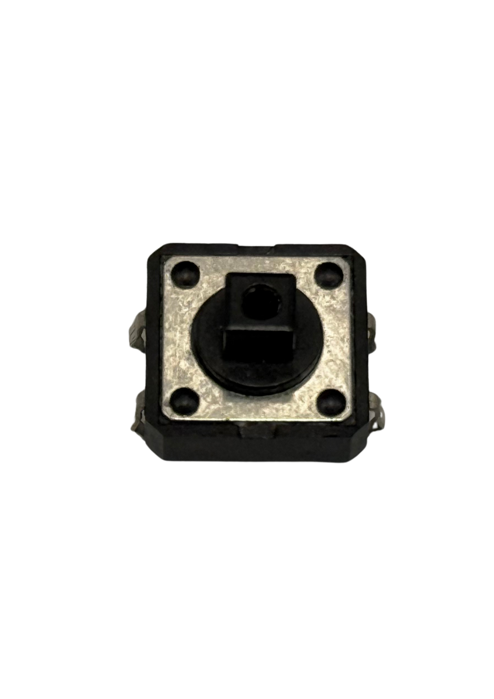
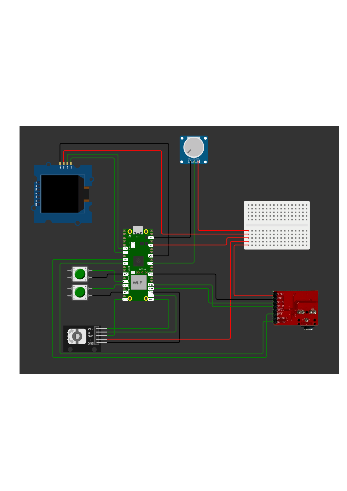

# FM radio receiver with digital tuning
This is a project for Digital Electronics 2 (BPC-DE2) on Brno University of Technology BUT FEEC.  
The goal of this project is to make a fully functional FM radio based on Raspberry Pi Pico W.

## Project functionality
A rotary encoder will adjust the FM module frequency, and pressing it will allow you to save the selected frequency to memory. By pressing button 1 or 2, you can switch between the saved frequencies. A potentiometer will be used to control the radio's volume. Both the frequency and the volume will be displayed on an OLED screen. If possible, the name of the radio station or the currently playing song will also be shown.

## Team members
+ **Martin Morávek** - *SW engineer + documentation* (Block schematic, rotary encoder, FM module and potentiometer testing, pinout)
+ **Adrian Munteanu** - *SW engineer and design* (Wiring diagram, photos/videos shooting, pinout)
+ **Antonín Navrkal** - *HW and SW engineer* (FM module and OLED display testing, pinout)
+ **Ondřej Pavliš** - *HW and SW engineer + documentation* (GitHub repository, FM module testing, pinout)

## Components used and Pin/Bus plan
| Raspberry Pi Pico W |
| :--- | 
|  |

| OLED Graphic Display Module | Signal  ->  GPIO / Pin |
| :--- | :--- |
|  | SDA    ->    GP4 SCL    ->    GP5 VCC    ->    3V3 GND    ->    GND |

| Rotary encoder | Signal  ->  GPIO / Pin |
| :--- | :--- |
|  | CLK    ->    GP16 DT    ->    GP17 SW    ->    GP15 +    ->    3V3 GND    ->    GND |

| FM STEREO module Si4703 | Signal -> GPIO / Pin |
| :--- | :--- |
|  | SDIO   ->   GP4 SCLK   ->   GP5 RST   ->   GP6 GPIO2   ->   GP7 VIN   ->   3V3 GND   ->   GND |

| Potentiometer | Signal -> GPIO / Pin |
| :--- | :--- |
|  | Middle pin   ->   GP26 Left pin   ->   3V3 Right pin   ->   GND |

| 2x Buttons | Signal -> GPIO / Pin |
| :--- | :--- |
|  | **Button 1** IN   ->   GP11 OUT   ->   GND  **Button 2** IN   ->   GP12 OUT   ->   GND |

## Block diagram

## Wiring diagram

## Testing individual components
### OLED Graphic Display Module 
- tested by wiring it to a breadboard, detecting it on the I2C bus and [displaying the text "Hello"](Images/Displaytestphoto.jpeg) using a [simple script](Test_codes/Testcode_display.py).

### FM STEREO module Si4703  
- similary to the Graphic Display this module was tested by [wiring it to a breadboard](Images/FMtest_photo.jpeg), detecting it on the I2C bus and [trying the radio connection](Images/FMtest.png) with a [script](Test_codes/Testcode_FMmodule.py). A library for the Si4703 chip was required for this task. 

### Rotary encoder 
- connected to Raspberry Pi Pico W and a [script](Test_codes/Testcode_encoder.py)  was used to monitor how the encoder's rotation value changes.

### Potentiometer
- also connected to Raspberry Pi Pico W, ADC values were monitored and then recalculated in [script](Test_codes/Testcode_potentiometer.py) to [show in volts](Encodertest.mp4).

## Timing/concurrency plan  
| **Week**| **Plan** |
|---|---|
| 1. | Team members, creating GitHub repository, approval on Block diagram / pinout |
| 2. | Testing modules / display, create complete wiring diagram  |
| 3. | Wiring of the entire circuit and putting it into operation  |
| 4. | Bug fixes, finishing documentation, making poster / short video  |
| 5. | Demonstration and defense |

