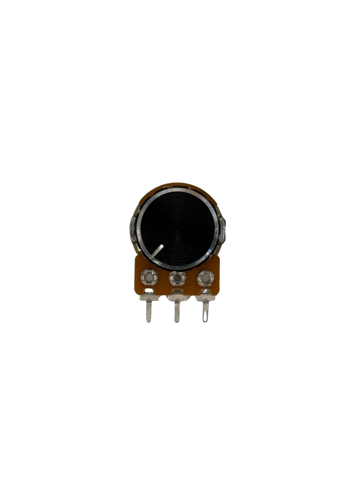

# FM radio receiver with digital tuning
This is a project for Digital Electronics 2 (BPC-DE2) on Brno University of Technology BUT FEEC.  
The goal of this project is to make a fully functional FM radion based on Raspberry PI Pico W.

## Team members
+ **Martin Morávek** - *SW engineer + documentation*
+ **Adrian Munteanu** - *SW engineer and design*
+ **Antonín Navrkal** - *HW and SW engineer*
+ **Ondřej Pavliš** - *HW and SW engineer + documentation*

## Components used and Pin/Bus plan
### Raspberry Pi Pico W
  <!-- Resize to 300px width -->

### OLED Graphic Display Module

| Signal | GPIO / Pin |
|---|---|
| SDA | GP4  |
| SCL | GP5  |
| VCC | 3V3 |
| GND | GND |

### Rotary encoder

| Signal | GPIO / Pin |
|---|---|
| CLK  | GP16 |
| DT  | GP17 |
| SW  | GP15 |
| + | 3V3 |
| GND | GND |

### FM STEREO module Si4703

| Signal | GPIO / Pin |
|---|---|
| SDIO  | GP4  |
| SCLK  | GP5  |
| RST | GP6 |
| GPIO2  | GP7 |
| VIN | 3V3 |
| GND | GND |

### Potentiometer

| Signal | GPIO / Pin |
|---|---|
| Middle pin | GP26  |
| Left pin | 3V3 |
| Right pin | GND |

### 2x Buttons

| **Button**| Signal | GPIO / Pin |
|---|---|---|
| **Button 1** | IN | GP11 |
| | OUT | GND |
| **Button 2** | IN | GP12 |
| | OUT | GND |

## Block diagram

## Timing/concurrency plan  
| **Week**| **Plan** |
|---|---|
| 1. | Team members, creating GitHub repository, approval on Block diagram / pinout |
| 2. | Testing modules / display, create complete wiring diagram  |
| 3. | Wiring of the entire circuit and putting it into operation  |
| 4. | Bug fixes, finishing documentation, making poster / short video  |
| 5. | Demonstration and defense |

